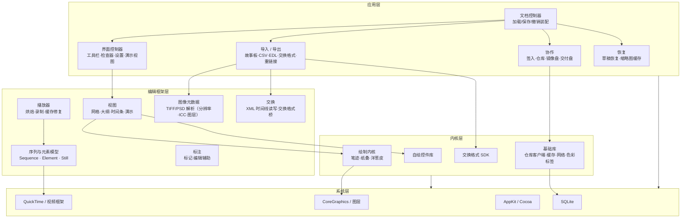

# PD2 设计文档
## 故事板演出工具的产品设计、系统架构与实现规范

| 项 | 内容 |
|---|---|
| 文档类型 | 产品 + 技术设计文档（可作为同类工具的设计基线） |
| 读者 | 产品负责人、客户端工程师、媒体管线工程师、后续接手维护者 |
| 范围 | 概念模型、数据模型、系统架构、关键机制、协作与交付流程、技术栈、实现规范与里程碑 |
| 不在范围 | 具体美术资产、品牌视觉、内部组织与人事流程 |

---

## 0. 摘要：十个设计决定

1. **产品不是画图工具，是"给静帧加上时间"的工具。** 数据核心只有两样：一串图 + 每张图的时长。绘画能力是附属品。
2. **播放不做实时合成。** 所有"图 + 时长"预先烘焙成一段代理影片，播放、拖动、循环、双屏演示、导出全部退化为"在影片里定位"。这是整套设计的地基。
3. **三级分辨率分离。** 绘制用板分辨率，审阅与播放用更低的缓存分辨率，导出再选一档；三个用途三套参数，绝不混用。
4. **时长是一等公民。** 每张板一个时长，序列一个默认时长，再加"设置 / 相加 / 相乘"三种选区运算、具名预设库，以及"边播边录"——让导演用看一遍来定节奏。
5. **草稿层是矢量，提交时才光栅化。** 编辑态保存笔迹（点、宽度、颜色、混合模式），草稿以“标记”挂在元素上；提交后作为图层写进板图、移除标记、丢弃矢量。因此**提交是单向门**：撤销不会还原文件，恢复走显式命令。
6. **文档是"包"，不是单文件。** 包内是模型归档、图片、代理影片、缩略图、身份与锁、三级恢复快照；图片本体可以外置，文档只存引用。
7. **协作模型是"仓库 + 独占锁 + 版本号 + 只读浏览端"。** 身份与锁用纯文本文件；版本号在仓库侧单调递增；只读端只依赖格式规范，不依赖编辑框架。冲突不合并——像素以磁盘为准、结构以文档为准、版本以新旧加人工确认为准。
8. **交付不是"导出文件"，是"有回执的社交动作"。** 预检 → 分配资产号与版本 → 调外部工具生成交换格式 → 暂存 → 上传代理 → 校验双方版本 → 生成翻页书 PDF → 发交付邮件。
9. **业务规则写进数据模型。** 元素来源类型（原始 / 已剪 / 剪辑影片 / 效果派生）决定"重新投递"是否合法；"只有清理、上色、调色能重投，改表演必须发新板"是产品规则，不是技术问题。
10. **量级要可解释。** 一个文档控制器膨胀到数百方法、上百成员变量，是这类工具最常见的坍塌点；设计时就要按用例切成服务，而不是靠分类（Category）拆文件。

---

## 1. 产品定位

### 1.1 一句话

PD2 是故事部门用的故事板演出工具：艺术家在里面画板、排顺序、调节奏，把一段静态故事板"演"给导演看，并在定稿后按剪辑部门的规矩把媒体投递进 Avid。

### 1.2 用户与场景

| 用户 | 场景 | 依赖的能力 |
|---|---|---|
| 故事艺术家 | 工位画板、排顺序、调节奏、发给导演看 | 草稿层、网格视图、时长表、播放器、双屏演示 |
| 故事制片 | 维护 show / 序列结构、催交、跟踪状态 | 项目设置、签入、签出窗口、状态列、交付报告 |
| 剪辑 / Editorial | 接收故事板媒体，剪进 animatic | 交换格式（EDL / XML / AAF / OMF）、翻页书 PDF、交付邮件 |

### 1.3 三条主路径

```
画 → 排 → 演  ──────────────► 本地价值（一个人就能完成）
     └→ 签入 → 交付 → 回执 ──► 组织价值（必须联网、必须有仓库）
                └→ 重新投递 / 发新板 ──► 版本治理
```

后两条路径承担的代码量与文档量最大：**协作与交付占整体工作量两成以上**，超过任何单一 UI 模块。这决定了排期——不要按"画图软件"估工。

### 1.4 明确不做的三件事

- **不做多轨剪辑。** 时间轴只有"每张停多久"这一维。真需要多轨就交回剪辑软件。
- **不做完整绘图软件。** 有笔迹、有压感、有洋葱皮，但没有图层混合、滤镜、选区、色彩管理。需要这些就去 Photoshop，工具负责往返。
- **不做资产管理系统。** 它只维护"哪张板是哪个资产号、第几版、在哪个文档里"，不承担资产的生命周期治理。

### 1.5 成功标准

一版新的故事板，从打开工具到能在会议室里"演"出来，不超过一次会议的准备时间；一次交付，从点按钮到剪辑能收到，不需要人工搬文件。

---

## 2. 概念模型

### 2.1 术语

| 术语 | 含义 | 关键属性 |
|---|---|---|
| **Fez / fezd** | 一个"故事板播放列表"文档包 | 序列树、时长、引用、缓存、身份、锁 |
| **Board（板）** | 一张故事板图；也是那个 TIFF 文件 | 图、时长、备注、对白、烧录字、翻转、宽高比、资产号 |
| **Sequence（序列）** | 一场戏；**本身也是元素**，所以可嵌套 | 子元素、当前元素、洋葱皮层数、播放时隐藏草稿 |
| **Element（元素）** | 时间轴上的一段：静帧、影片、图像序列、嵌套序列 | 入点、出点、在序列中的起点、媒体偏移、标记、状态 |
| **Sketch（草稿）** | 叠在板上的矢量笔迹层 | 笔迹集合、图层、洋葱皮、撤销 |
| **Check In（签入）** | 把文档与板复制进仓库，产生新版本 | 版本号、索引行 |
| **Blowover** | 对"已交付板"发新版本，替换剪辑里的旧版 | 资产号、版本、元素来源类型 |
| **Idea Bin（灵感板）** | 跨文档共享的图库（个人 / 序列两级） | 分组、作者、状态、是否已被取用 |
| **Flipbook** | 每页 N 格的 PDF，交付清单与审阅载体 | 版式、页脚字段、状态高亮 |
| **Working Session** | 在剪辑室现场改板、只交付选中几块 | 临时交付模式、邮件收件人 |

### 2.2 对象关系

```
文档（Fez）
 └─ 序列（Sequence）           ← 也是 Element，可无限嵌套
      ├─ 元素（Element）        ← 带 in/out 与序列内起点
      │    ├─ 静帧（Still）     ← 板图 + 时长 + 备注/对白
      │    ├─ 影片（Movie）     ← 可直接放带 in/out 的片段
      │    ├─ 图像序列（ImageSequence）
      │    └─ 序列（嵌套）
      ├─ 草稿（Sketch）          ← 挂在元素上，可多层
      └─ 标记（Marker）          ← 挂在元素或序列上，可切分元素
```

两个不寻常但要保留的设计：

1. **序列同时是元素。** "序列里放序列"天然成立（镜头组、镜次），树深不受限，UI 用大纲视图呈现。
2. **元素带 in/out 与媒体偏移。** 它不只能放静帧，还能放带入出点的影片片段。故事板工具用上了剪辑软件的语义，这是它能与剪辑部门对话的前提。

### 2.3 板的一生

```
                ┌──────────── 编辑中 ────────────┐
                │ 草稿为矢量 / 可撤销 / 未签入     │
                └───────┬───────────────┬────────┘
         提交草稿(光栅化) │               │ 签入
                ┌───────▼───────┐   ┌───▼─────────────┐
                │ 定稿板（TIFF） │──▶│ 已签入（新版本）  │
                └───────────────┘   └───┬─────────────┘
                                        │ 交付
                                ┌───────▼─────────────┐
                                │ 已交付（有资产号）   │
                                └───┬─────────────┬───┘
                    再改 + 重投 │                 │ 再改 + 发新板
                          ┌─────▼──────┐    ┌─────▼──────────┐
                          │ 替换旧版本  │    │ 新资产号        │
                          │（旧版不可见）│    │（旧板仍在剪辑） │
                          └────────────┘    └────────────────┘
```

交付前置条件（全部要在 UI 里显式阻断，而不是发出去再报错）：草稿已提交、板已签入、图不缺失、板不为空、帧数不异常、元素属于本文档的 show 与序列。

---

## 3. 数据模型

### 3.1 元素字段

| 字段 | 类型 | 说明 |
|---|---|---|
| `undoManager` | 撤销栈 | 每个元素自带，但**建议**上移到文档层（见 §8.6） |
| `inTime` / `outTime` | 时间 | 媒体入出点 |
| `startTimeInSequence` | 时间 | 在序列中的起点（由前序累计得出，不落盘更安全） |
| `duration` | 时间 | 元素时长 |
| `movieDuration` | 时间 | 媒体本身时长（未加载时用） |
| `offsetIntoMovie` | 时间 | 在共享影片（代理缓存）中的偏移 |
| `properties` | 字典 | show 相关的可扩展属性 |
| `url` | 路径 | 源媒体 |
| `urlContentsSize` | 数字 | 文件大小，用于进度与空间估算 |
| `sharedMovieURL` | 路径 | 指向代理缓存中的一段 |
| `previewURL` | 路径 | 低质量预览 |
| `thumbnailMaxSize` / `thumbnail` | 尺寸 / 图 | 缩略图 |
| `playOrder` | 整数 | 播放顺序 |
| `name` | 字符串 | 显示名 |
| `parent` / `identifier` | 引用 / 数字 | 分组与内部标识 |
| `markers` | 数组 | 审片标记（备注、对白、草稿、镜头） |
| `uid` | 字符串 | **跨文档稳定 ID**，录制时长与缓存重定向都靠它 |
| `shotStartFrame` / `shotEndFrame` | 整数 | 对应剪辑镜头的帧范围 |
| `status` | 字符串 | `new` / `new version` / `delivered` 等 |
| `mutable` | 布尔 | 只读锁定（他人正在编辑、或来自其他 show） |
| `elementType` | 枚举 | 来源类型，见 §3.5 |

影片类元素额外带一组**每元素独立的背景音视频**：`backgroundVideo/URL/Range/UseRange/Repeats/Offset`、`backgroundAudio/…`。含义是"参考实拍可以贴在某几张板底下、循环、只取一段"。

### 3.2 序列与板

**序列**：`elements`、`currentElementIndex`、`durationOfChildrenIsCached`、`ghostCount`（洋葱皮层数）、`hideSketchesDuringPlayback`、`clearBackgroundTrack`（可选的黑场轨）。

**板（静帧元素）**：`srcURL`、`cropRect`、`srcThumbnail`、`flopped`、`modificationDate`、`dirty`、`useMoviePosterImage`，另有板级元数据：`duration`、`note`、`dialog`、`burnin`、`aspectRatio`、`storyboardID`、`oid`。

这里有一条重要区分：**"板"是产品概念，"静帧元素"是数据概念。** 板被复制成多个版本时，共享同一张源图但各自有资产号；把它们混成一个对象，后面所有版本逻辑都会写错。

### 3.3 文档包结构

```
Scene_01.fezd/                     ← 目录型包，Finder 中显示为单个文件
├── doc.fez / doc.fez2             ← 模型归档；新格式与旧格式并存
├── previousDoc.fez / .fez2        ← 上一版快照
├── autosaveDoc.fez2               ← 自动保存（全屏双屏模式下关闭）
├── document_id                    ← 纯文本：文档 UUID
├── lockedBy                       ← 纯文本：谁锁了这个文档
├── boards/
│   ├── <name>.tif                 ← 故事板定稿图（TIFF，硬交换格式）
│   ├── sketch#<n>.tif             ← 已提交的草稿栅格
│   └── sketchBG#<n>.tif           ← 草稿背景层
├── movies/
│   ├── stillImageCache.mov        ← 全序列预烘焙代理（播放/拖动/循环都靠它）
│   └── videoCache.mov             ← 影片元素的代理缓存
├── thumbnails/                    ← 缩略图 JPEG（可整体丢弃重建）
├── sketches_backup/               ← 草稿存档（保存时移入；工作区残留＝上次崩溃）
├── sketches_committed/            ← 提交草稿时的归档目录（提交过程的中间产物）
└── preview.mov                    ← 整段预览，供只读浏览端使用
```

设计要点：

- **图片外置、文档只存相对路径。** 同一张板可被多个文档引用，不必复制几十 MB；代价是必须提供"缺图诊断 + 重链接"。
- **缓存是文档的一部分。** 代理影片跟着包走，换机器直接可播；也可以整体删除，只是慢。
- **身份与锁是纯文本文件。** 跨机器锁不需要数据库；坏了好排查。

### 3.4 身份、版本与命名

| 标识 | 形态 | 分配时机 | 用途 |
|---|---|---|---|
| `document_id` | UUID 文本 | 创建文档 | 跨机器识别"同一个文档" |
| `uid`（元素） | 字符串 | 创建元素 | 录制时长、撤销、缓存重定向的稳定键 |
| `storyboardID` | `<show>_<6 位数字>`，例 `m2_000691` | **首次交付** | 对剪辑的资产身份；进过剪辑就靠它追踪 |
| `assetId` | 仓库字符串 | 签入 | 资产主键 |
| `version` | 整数，单调递增 | 仓库 | 新版本 / 重投递的判定依据 |

交付介质在交付盘上的命名规则（版本号写进文件名，目录承担分类）：

```
/shows/<show>/diskfarm/TAKES_storybrd_<seq>/take_<take><suffix>/
        TAKES_storybrd_<seq>.take_<take><suffix>.<version>.tif
/shows/<show>/diskfarm/TAKES_storybrd_<seq>/take_<take><suffix>_mov/
        TAKES_<show>.take_<take><suffix>_mov.0.mov
/shows/<show>/proxydisk/story/…                     ← 审阅镜像
```

好处：**版本索引在文件系统里就成立**，数据库只是缓存；`ls` 就能回答"这块板最高版本是多少"。

### 3.5 用枚举表达业务规则

凡是"分支里出现两次以上、业务人员会讨论"的概念，都应该建模成枚举，而不是字符串。这类工具至少要定义：

| 枚举 | 值 | 规定的规则 |
|---|---|---|
| `ElementProvenance` | `undefined` / `editorialMovie` / `original` / `originalEdited` / `effectDerived` | 决定交付时能否重投、要不要重新生成媒体 |
| `DeliveryMode` | `normal` / `redeliverUnchanged` / `regenerateUnchanged` | 三种交付行为，见 §5.7 |
| `DocumentErrorCode` | `none` / `gateway` / `sketchCommitToMovie` / `sketchCommitWriteLayer` | 草稿提交失败必须单独上报（它是最常见故障） |
| `AssetLinkAction` | `unlink` / `linkback` | 元素与源图两态，是"新板 vs 新版本"的判定开关 |
| `PrintLayout` | `contactSheet` / `flipbook` / `image1` / `image2` / `image3` | 同一份数据五种输出 |
| `AccessLevel` | `admin` / `user` / `none` | 只读端与编辑端共用一份文档，靠它决定能做什么 |

反例：`status` 用裸字符串存（`new` / `new version` / `delivered`）。拼错只能运行时才发现，且无法穷举。**新实现一律用枚举 + 显示名分离。**

### 3.6 兼容与容错

这类工具的生命周期以"年"计，格式必须能演进。四条硬要求：

1. **格式带版本号**，并且读写分离：读旧写新，必要时并存两代（`doc.fez` / `doc.fez2` 就是没有迁移器时代的土办法）。
2. **未知字段透传**：读进来不认识的键保留，写回时带回，避免"新版本存、旧版本开"丢数据。
3. **未知类型降级**：无法识别的节点变成占位块（保留原始数据），**不让整包打不开**。
4. **缺资源不阻断打开**：图或影片缺失时，元素标记为"未解析"，顶部提示 + 一键重链接。

---

## 4. 系统架构

### 4.1 部署拓扑

```
┌─────────────── 艺术家工作站 ───────────────┐
│ 客户端应用                                  │
│  ├─ ~/Pitches/<show>/<seq>_<date>/X.fezd   │  本地工作副本（含代理缓存）
│  └─ 临时交付暂存目录                        │  上传前的落地区
└───────────────┬────────────────────────────┘
                │ 共享文件系统（NFS / SMB），不是 HTTP API
      ┌─────────┴──────────┬────────────────────┐
┌─────▼──────┐   ┌─────────▼────────┐   ┌───────▼────────┐
│ 资产仓库    │   │ 审阅镜像盘        │   │ 交付媒体盘      │
│ 版本/元数据 │   │ /shows/<s>/      │   │ TIFF / AAF      │
│ + 关系库    │   │  proxydisk/story │   │ /shows/<s>/     │
│ (目录鉴权)  │   │                  │   │  diskfarm/…     │
└────────────┘   └──────────────────┘   └───────┬────────┘
                                                 │ 交换格式 + TIFF
                                         ┌───────▼────────┐
                                         │ 剪辑（Avid）    │
                                         └────────────────┘
```

这不是客户端—服务器架构，而是**共享文件系统 + 一个薄数据库**。所有"远程"操作本质是"在挂载点读写某个路径"。

- 优点：实现极简，出问题能直接用 Finder 排查，运维成本低。
- 代价：离线即失效，权限问题会以"文件打不开"的形式暴露，因此必须配"取本地副本"与"重链接"（§6.5）。

### 4.2 分层



### 4.3 模块职责

| 模块 | 职责 | 优先级 |
|---|---|---|
| 文档 / 模型 | 加载、序列树、元素、时长、标记、撤销 | P0 |
| 播放器 | 时间基准、当前元素、播放/暂停/循环、录制 | P0 |
| 烘焙 / 缓存 | 图 + 时长 → 代理影片；修复、重建、进度 | P0 |
| 网格视图 | 缩略图墙、拖拽重排、多选、缩放 | P0 |
| 时间条 | 单维时间、播放头、标记、拖拽改时长 | P1 |
| 大纲 | 镜头 / 场景层级 | P1 |
| 检查器 | 单元素属性（备注、对白、时长、背景音视频） | P1 |
| 草稿 | 矢量笔迹、纸叠、洋葱皮、提交光栅化 | P1 |
| 打印 / 翻页书 | 分页排版、页脚字段、状态高亮 | P2 |
| 交换 | EDL / XML / AAF / OMF / CSV | P2 |
| 仓库 | 锁、签入、版本、离线、灵感板 | P3（可先做本地版） |

### 4.4 只读浏览端

仓库里会有成百上千个文档，需要一个**只读浏览端**（随应用分发的小客户端）来解决"我要找去年那版板"：

- 只读文档包里的**元数据投影**，不加载图片；一屏列表在秒级打开。
- 自带本地索引（SQLite），按 show / 序列 / 作者 / 状态 / 日期筛选。
- 能把远程包**批量复制到本地**，带进度、可取消、有错误摘要。
- **只依赖格式规范，不链接编辑框架。** 这条是格式设计好坏的试金石：如果读一个文档必须链接整个编辑框架，格式就没有独立价值。

### 4.5 三个缓存，三种生命周期

| 缓存 | 位置 | 失效条件 | 重建代价 |
|---|---|---|---|
| 代理影片 | `movies/stillImageCache.mov` | 源图变、时长变、分辨率/编码变、文件损坏 | 高（分钟级，按元素与 GB 报进度） |
| 缩略图 | `thumbnails/` | 低内存、显式清理、源图变 | 低（可随手删） |
| 仓库元数据 | 内存/磁盘缓存 | 签入分析、交付分析后失效 | 中（网络往返） |

原则：**把"慢但可丢"和"快但必须准"分开缓存**，并且让用户看得见代价。用户知道为什么等 8 分钟，就不会以为程序挂了。

---

## 5. 关键机制

### 5.1 代理影片：把"播放"变成"定位"

**问题**：几十到几百张高分辨率静帧，每张停 1–4 秒，要能随时播放、拖动、倒放、循环、双屏投放，还要能直接导出视频。实时逐帧合成会卡，而且"播放"和"导出"两套代码容易不一致。

**方案**：把"图 + 时长"一次性烘成一段影片；之后所有操作都是 seek。

```
boards/*.tif + duration ──烘焙──▶ movies/stillImageCache.mov（缓存分辨率 + 预设压缩）
                                        │
播放 / 拖动 / 循环 / 双屏 / 导出 ───────┘  只是定位
```

**实现（ffmpeg 版）**：

```ts
type BakeInput = {
  items: Array<{ src: string; frames: number; inFrame?: number; outFrame?: number;
                 bgVideo?: string; bgAudio?: string; burnin?: string }>;
  fps: 24 | 25 | 30;
  size: [number, number];                    // 缓存分辨率
  codec: { v: 'h264' | 'prores'; crf?: number; gop?: number };
};

function bakeSignature(i: BakeInput, srcHashes: Record<string, string>): string {
  // 任何会影响像素或时长的输入都必须进签名，否则会误用旧缓存
  return sha1(JSON.stringify({ ...i, srcHashes }));
}

async function bake(i: BakeInput, out: string, onProgress: (p: Progress) => void) {
  const inputs: string[] = [];
  for (const it of i.items) {
    const dur = it.frames / i.fps;
    inputs.push(`-loop 1 -t ${dur} -i "${it.src}"`);
    if (it.bgVideo) inputs.push(`-stream_loop -1 -i "${it.bgVideo}"`);
  }
  await run('ffmpeg', [
    '-y', ...inputs,
    '-filter_complex', buildFilterGraph(i),   // 每段 scale+crop+sar，烧录 burnin
    '-c:v', i.codec.v,
    '-g', String(i.codec.gop ?? 12),          // 关键帧要密，seek 才准
    '-pix_fmt', 'yuv420p',
    tmpPath(out),
  ]);
  await fs.rename(tmpPath(out), out);         // 原子替换，断电不留半个文件
}
```

**必须一起做的四件事**（只做烘焙会得到一个难用的工具）：

1. **逐元素修补**：只重烘变了的段，其余复用。
2. **进度与预计耗时**：按元素序号 + 已处理 MB/GB 报告。
3. **整体可丢弃**：一键 blow / rebuild，明确告知"可能很久"。
4. **时长上限**：每张静帧有最大时长，防止一张"板"占十分钟撑爆缓存。

**代价**：改时长或换图就要重烘。这是设计的一部分，不是缺陷——所以上面四件事是必需的，不是优化。

### 5.2 多分辨率

| 用途 | 尺寸 | 说明 |
|---|---|---|
| 绘制 | 板分辨率 | 艺术家按项目规格画（常见 1920×1080 或更高） |
| 审阅 / 播放 | 缓存分辨率 | 更低一档，烘焙时统一缩放；缺失时回退到默认值并提示 |
| 导出 | 导出档 | 演示用可临时调高到 1080p，代价是重建缓存 |

三者是**独立设置**，不是同一个值的换算。混用会导致"画的时候糊"或"播的时候卡"。

### 5.3 时长代数与边播边录

导演说"这段太慢了"，逐个改秒数是最笨的交互。设计成选区 + 运算 + 预设：

```
选中 N 个元素
 ├─ 设置   ：全部设为 D
 ├─ 相加   ：每个 ±Δ
 ├─ 相乘   ：每个 ×k（0.5 = 快一倍）
 ├─ 复位   ：回到序列默认时长
 ├─ 预设   ：存/取"2 秒 / 1.5 秒 / 0.5 秒"这类常用档
 └─ 录制   ：播放时记录每张实际停留时间，播完批量套用
```

录制实现要点：以元素 `uid` 为键记录区间，停止后得到"这一遍实际停留"的字典；应用时再换算成帧数，并且只对选中范围生效。

```ts
let t0 = 0, lastUid: string | null = null;
onPlayhead((uid, now) => {
  if (lastUid && lastUid !== uid) recorded[lastUid] = now - t0, t0 = now;
  if (!lastUid) t0 = now;
  lastUid = uid;
});
```

注意：录制结果是"素材"，不是"答案"。必须能预览、能只应用选中段、能一次撤销。

### 5.4 草稿层：矢量编辑、光栅提交

**问题**：评审时导演要在板上圈两笔，但定稿图是 `boards/<name>.tif`，不能让艺术家每次都回 Photoshop。

**模型**：

```
纸叠（SketchStack）
 ├─ 纸（SketchSheet）：尺寸、变换（平移/缩放/旋转）、背景图、隐藏/锁定、缩略图
 │    └─ 笔迹（Stroke）：若干条路径，每条是点序列 + 宽度
 │         ├─ 颜色、混合模式
 │         ├─ 橡皮（宽度为负即橡皮）
 │         └─ 起止时间
 └─ 洋葱皮：前 N 张的合成图 + 起始透明度
```

**输入模型**：压感与倾斜驱动线宽；关闭系统事件合并以降低延迟；区分笔与鼠标；笔离开纸面即结束一笔。

**状态机**（同一张板上，草稿只有三态）：

```
未画 ──新增草稿──► 编辑中（矢量；以“草稿标记”挂在元素上，实时叠加）
                      │
                   提交│  ← 单向门
                      ▼
                 已提交（像素在板图图层里；草稿标记被移除，叠加消失）
                      │
        恢复草稿（显式命令，指定一个文档）│
                      ▼
                 编辑中（栅格底；能继续画，但原始笔迹已不在）
```

**草稿的“存在”是一条记录，不是一个画布对象。** 元素上挂着若干“草稿标记”，每个标记指向一叠纸；`hasSketches` 由标记推出来。这就解释了提交后叠加为什么会消失：**它删的是标记，不是画布**。如果只清画布不删标记，同一笔会被画两遍——一次来自图层，一次来自叠加。

**提交的七步，顺序不能换**：

| # | 步骤 | 为什么必须在这个位置 |
|---|---|---|
| 1 | 剔除空草稿 | 先删掉“一笔没画”的草稿标记，避免把白图合进板图 |
| 2 | 光栅化 + 空图检查 | 用缓存分辨率算缩略图并判空；空白直接中止 |
| 3 | 写草稿栅格（原子写） | 先落盘，后面任何一步失败都还有原始草稿可查 |
| 4 | 写完再验一次 | 读文件大小、再判一次空；仍空白就抛错中止 |
| 5 | 板图取本地副本 | 防的是“板图在审阅盘上、写不进去” |
| 6 | 备份原板图 | 移进备份目录、用唯一名；这一步失败时板图还没动 |
| 7 | 合层 + 原子写回 | 打开分层 TIFF → 加一层 → 写临时文件 → 改名 |

**合层有两条实现路线，结果一样**：

- **自己写**：用分层 TIFF 库打开板图，加图层（草稿与背景各一层），再原子写回；这条路**失败会自动改用 Photoshop 那条**（日志里写得很直白：“用分层 TIFF 写失败，改试脚本方式”）；
- **交给 Photoshop**：把脚本模板里的两个占位符填成“板图路径 / 草稿路径”，执行脚本，再读它写出的结果文件判断成败（脚本结束时回写一个完成标记）。

**失败即中止，不写坏文件**：空白图、读不到文件、没有写权限、合层失败——都会停在“已备份、未写回”这个安全点。

**提交前的三道门**（任一不满足就拒绝，且不产生任何文件改动）：

| 门 | 判据 | 拒绝时 |
|---|---|---|
| 有草稿 | 该元素至少有一个**非空**草稿 | 静默跳过，不报错 |
| 元素可用 | 板图文件**存在且可读** | 报“打不开 / 读不到”，不备份、不合层 |
| 类型允许 | 不是影片、不是剪辑效果组件 | 明确提示“不能把草稿提交到影片上” |

类型这道门按**元素来源**判断（未定义 / 原始媒体 / 原始已剪 / 影片 / 效果组件五类），只放行“真实板图”那几类。这是业务语义，不是技术限制：影片没有“那一张板图”可合并。

**草稿文件的命名规则**：

```
<板图目录>/sketch#<序号><后缀>.tif      草稿层
<板图目录>/sketchBG#<序号><后缀>.tif    草稿背景层
后缀 = ""  或  "_for_<艺术家>_in_<文档>"
```

后缀只在**同名文件已存在**时追加——换人接手同一张板时，不覆盖前一个人的草稿。这是个很便宜的多写保护。

**两种“空白”含义完全不同**（这点最容易做错）：

| 时机 | 含义 | 处理 |
|---|---|---|
| 写盘**前**判空 | 这笔草稿确实没内容 | 不写文件，只清掉纸叠，按“空草稿”正常结束 |
| 写盘**后**再判空 | 写出来的 TIFF 是白的（数据丢了） | 抛错、报“草稿可能已损坏”，停在已备份、未合层 |

把这两件事合并成一条“空白就报错”，会让“随手新建一个空草稿”变成故障；合并成“空白就忽略”，则会真的吞掉数据。

**提交成功后还要做三件事**：

1. **移除草稿标记** → `hasSketches` 变假 → 叠加消失；
2. **更新元素**（缩略图、代理影片标记为过期）；
3. **同步所有克隆**——克隆的判定是“同名 + 对应同一组剪辑元素 + 指向同一个文件”，不是“长得像”。

并且**保留用户原来的选中与播放头**：提交是批量操作，不能把正在看的位置弄丢。

**撤销与提交的关系**（最容易误解的一点）：

- 提交**不登记撤销**：它是文件事务，不进文档撤销栈。
- 取消只做界面收尾（收起进度条、重连视图、刷新签入状态），**不回滚文件**。
- 恢复是独立命令，界面是一个“恢复草稿”面板：它**直接列出 `<文档>/sketches_backup/` 里的备份**，选一份，再交给序列把这份备份里的草稿装回元素——装回的是草稿纸叠本身，不是从已提交的图层里反推像素。
- 对不上现有板的草稿不会被丢掉，也不会硬塞给某张板：会**新建一张板**收留它（孤儿草稿也有归宿）。
- 备份目录同时是崩溃检测的依据：正常情况下保存时草稿会被**移进** `sketches_backup/`；如果启动时发现工作区里还留着没被移走的草稿，就判定“上次是崩溃退出的”，才会主动提示恢复。换句话说，它不靠标志位判断崩溃，靠“该被移走的东西还在”。

**提交时还要处理的两件周边事**：

- **影片元素**：不能把草稿提交到影片上（影片没有“那张板图”）。
- **签入 / 交付的前置**：未提交草稿必须拦一下——
  - 签入时三选一：`提交并签入` / `跳过并签入` / `取消并复查`；
  - 交付时提示“本文档还有未提交草稿，是否继续”。

**建议改进**：

- 提交后仍保留矢量文件（`sketch/<boardId>.vec.json`），磁盘几乎不花钱，换来的“重新编辑草稿”能力很值。
- 提交产物按 TIFF 落盘（团队混用 PS / Storyboard Pro，TIFF 是硬交换格式），另存一张 PNG 给 Web 预览。
- 提交日志记下“哪一层、哪张图、耗时”，出问题能定位到具体板。

### 5.5 洋葱皮与标记

- **洋葱皮是序列级能力，不是画布级。** 它需要"前 N 张板"的合成图，按透明度阶梯叠在下面；播放时自动隐藏，否则画面很脏。层数可调，缓存要能失效重建。
- **标记是审片接口。** 至少四类：备注、对白、草稿、镜头。对白是结构化单字段（要进交换格式），不是自由文本。
- **标记可以切分元素。** "一个板承载多个镜头"就是把元素在标记处 split，这是剪辑侧的常见需求。

### 5.6 三种输出物

同一份数据要有三种"纸"，只做一种会立刻不够用：

| 产物 | 形态 | 给谁 | 要点 |
|---|---|---|---|
| **翻页书 PDF** | 每页 N 格（通常 8） | 剪辑、导演、归档 | 页脚可选：草稿、页码、日期时间、边框、作者、序列名号、备注；**按状态高亮**（新板 / 新版本 / 重投递不同色） |
| **拼版 PSD** | 每页 3×3 九宫格，300dpi | 故事艺术家 | 每格贴一张板 + 对白文字层；缺图写 "Missing Image"；供 Photoshop 批量修订 |
| **CSV** | 一张表：字段 → 列名 | 制片 | 任意字段可导出/导入；同目录的图一并导入；批量改字段不必进 GUI |

**实现建议**：把导出抽象成 `Exporter` 接口（`pdf | psd | csv | mp4 | edl | xml`），每个只依赖扁平的"行"（元素 → 字段）。反例是把导出逻辑挂在一堆控制器上，同一字段的取值规则在打印、CSV、交付三处重复。

### 5.7 交付流水线

**问题**：要往剪辑里送故事板，必须产出交换格式与对应 TIFF，还要版本正确、命名正确、能被剪辑立刻找到。

**方案**：客户端只做编排，编码交给外部工具（随包的命令行程序或独立服务）。

```
preflight(文档, 选区)
 ├─ 草稿未提交？        → 阻断（列出板名）
 ├─ 缺图 / 空板？       → 阻断
 ├─ 未签入？            → 阻断
 ├─ 帧数异常（>300）？  → 警告
 ├─ 跨 show / 跨序列？  → 阻断或提示断开链接
 └─ 已交付且未变？      → 标记 skip
plan:    资产号（新的分配）+ 版本（下一个）+ 交付盘路径
generate: 媒体（每板 TIFF，按命名模板）+ 合成（交换格式）
stage:    写到暂存目录
upload:   调上传代理（异步，轮询输出），成功后清理暂存
verify:   仓库版本 vs 交付盘文件名版本；不一致即报错
publish:  翻页书 PDF + 交付邮件（收件人、备注、工单链接）
```

**三种交付模式**（必须都支持）：

| 模式 | 行为 |
|---|---|
| 正常 | 只发"新板 + 变过的板" |
| 重投递未变板 | 把没变的板从交付盘原样再送一次 |
| 重新生成未变板 | 强制按当前元数据重新 conform（例如序列号变了） |

后两种存在的理由：**"板没变"和"剪辑需要的元数据变了"是两件事**——版本号、序列号、效果链都在交换格式里，图没变也得重出。

---

### 5.8 两边都改了：三层冲突模型

真实工作里，“同一张图两边都改过”是常态：艺术家在 Photoshop 里改底图，同一个人在工具里改了时长、画了草稿。**这个工具不做合并**，而是把冲突拆成三层，每层一条规则。

| 层 | 规则 | 谁赢 | 为什么 |
|---|---|---|---|
| **像素**（图片文件） | 单向同步：从磁盘拉回文档 | 外部软件 | 两张 TIFF 没有“合并”的语义，硬合只会造出第三种错误 |
| **文档**（时长/顺序/备注/草稿） | 这些不在图片文件里 | 工具自己 | 图片更新不会覆盖结构化数据 |
| **版本**（仓库/交付） | 比新旧 + 人工确认 | 新的，但要人点头 | 交付有业务后果，自动化做不了判断 |

#### 像素层：叫“同步”，不叫“合并”

- 有一个显式命令：**“同步图像与其磁盘源文件”**（File 菜单 + 工具栏），两阶段执行：先找出变过的元素，再逐个更新（缩略图 + 代理影片一起重建）。
- 还有一个**自动同步开关**，它是一等功能，不是隐藏设置。关闭时会拦一下（“关闭自动同步？”/“保持开启”），并提示“你也可以手动从菜单同步”。
- **阈值是 5 秒**：一次同步超过 5 秒，它会自动把自动同步关掉，并提示改用手动。这条很实用——慢同步是“卡”的来源，而不是“同步”的失败。
- 同步**不进撤销栈**：它把外部变化当成客观事实，不算用户的编辑。
- 同步结束后会顺手刷新签入状态（否则界面还显示“已签入”，其实文件已经变了）。
- 锁定的文档 / 锁定的元素**不允许同步**——不硬来。

判断“改没改”的依据是**文件修改时间**，不是内容哈希；比较发生在“取本地副本”这一步（源文件与本地副本各取一次修改时间）。这是个可以改进的点：

| 现状 | 后果 | 建议 |
|---|---|---|
| 比 `mtime` | 别人只是“另存为同名”或还原备份，时间变了但内容没变 → 白重建一次缓存；反过来，某些工具保留原 mtime → 改了也不被发现 | 同时记内容指纹（hash）：时间变了才去算 hash，hash 变了才重建 |

#### 文档层：哪些东西不会被图片覆盖

- 时长、顺序、备注、对白、标记、裁剪、翻转 —— 都是文档属性，同步不碰。
- **草稿是独立图层文件**，不在板图里；外部改底图不会擦掉草稿。代价是底图变了以后，缩略图与代理影片必须重做（它们从像素派生）。

#### 版本层：比新旧，然后让人确认

- 签入前做一次后台分析，给每个元素一个**建议动作**（详见 §6.2），人可以改。
- 仓库比你新 → 自动改成“取最新”（而不是硬塞你的版本）。
- 你比仓库新 → 允许签入，但会明确告诉你“你的版本更新”。
- 交付时还会比“原图时间 vs 已生成媒体的时间”：原图在媒体生成之后又变过 → 提示媒体可能过期，需要重新生成。

#### 给复刻者的三条硬规则

1. **像素永远单向**：外部改了就拉，绝不做“像素合并”。
2. **结构化数据独立存放**：草稿分层、元数据进库，这样两边的改动才能共存。
3. **版本必须显式**：能回答“谁新”，且要人确认；已交付的东西不要自动覆盖。

一条体验建议：同步替换了某张板时，**UI 要能解释“为什么这张变了”**（哪个文件、什么时候改的、换了什么）。否则用户只会觉得“我的画被吃了”。

### 5.9 版本陈旧上报与权限

**过期检查只有一条规则**：启动时比较“构建日期 + 365 天”与当前时间；超了就把一句话写进日志，并**自动发一封邮件给支持邮箱**（主题固定为“PD2 Expired!”，正文是“某用户在某机器上运行的是很旧的版本，构建于 X”）。

- 它是**上报**，不是许可证：不联网校验、不要密钥、不禁止使用；邮件走的是现成的问题报告通道。
- 为什么这么做：内部工具最怕“一年前的版本还在跑”（交付格式可能已经变了），但又不能真锁死（离线、演示、归档都可能要用）。**记录 + 上报**是唯一能同时满足两边的做法。
- 代价是**用户完全没有感知**：界面上什么都不弹，只有日志和运维邮箱知道。复刻时建议补一条可见提示，否则“我在用旧版本”这件事永远传不到使用者耳朵里。
- 权限是另一件事：管理员名单来自每个 show 的编辑配置（谁能改交付参数），另有对交付盘宿主机权限位的检查（应当是 6555）。这些都不决定“谁能打开软件”。

## 6. 协作、版本与离线

### 6.1 锁

- 锁是文档包内的一个纯文本文件，内容是用户名；另附手动锁定原因。
- 打开被锁文档 → 只读模式，标题栏标注 `(Locked)` 与锁持有者。
- 没有租约与超时，所以必须提供"强制解锁"的人工路径，并把原因写进文件。
- 建议改进：`lock.json` 记录 `{user, host, since, reason}`，前端只做提示不做强制，冲突以服务端为准。

### 6.2 签入

```
1. 校验：本地文件都在、show/序列匹配、无未提交草稿
2. 复制：文档包 + 板 → 仓库（或审阅镜像盘）
3. 版本：仓库取 max(version) + 1；写索引行（资产号、版本、作者、序列、日期、文件名）
4. 回写：文档内记录新版本与资产号
5. 冲突：仓库版本与文件名版本不一致 → 拒绝并提示人工处理
```

版本号有两个来源（数据库、文件名），**必须一致**；不一致就停下来让人修。这是"宁可停，不要错"的取舍——错版本进了剪辑，代价远高于停一次。

签入不是"上传按钮"，而是**一次带建议的检查**。后台先做一遍分析，给每个元素一个建议动作，人可以逐条改：

| 建议动作 | 什么时候给 | 含义 |
|---|---|---|
| 签入新元素 | 这张板还没有资产号 | 分配资产号与第 1 版 |
| 签入新版本 | 已签入过，内容变了 | 版本 +1 |
| 取最新 | 仓库里的版本比你新 | 放弃本地这份，拉仓库的 |
| 不做任何事 | 已交付且没变、或重复 | 跳过这条 |

规则要点：

- **建议可以被覆盖，但非法组合要拒绝**（比如"取最新"用在从未签入过的元素上）。
- 仓库比你新时**自动改成"取最新"**，而不是硬塞你的版本——这是"宁可停，不要错"的延伸。
- 你比仓库新时允许签入，但明确告诉你"你的版本更新"，避免你以为对方更新过。
- 未提交草稿在签入前拦一下，三选一：**提交并签入** / **跳过并签入** / **取消并复查**。

### 6.3 冲突处理：不合，只分层

签入与交付都不做内容合并，冲突按三层各自处理：

| 冲突 | 判定 | 处理 |
|---|---|---|
| 两边都改了同一张图的像素 | 文件修改时间（建议加内容指纹） | 以磁盘文件为准，同步拉回；不做像素合并 |
| 两个人改了同一份文档 | 锁 + 版本比较 | 后到者取最新或放弃；不做行级合并 |
| 已交付的板又被改 | 版本 + 元素来源类型 | 只有清理/上色/调色能重投（blowover），改表演必须发新板 |

这条边界的意义：**合并需要"语义"，而像素没有语义。** 所以工具把可合并的东西（结构化字段）和不可合并的东西（像素）分开存放，冲突自然降级成"分工"。

### 6.4 存储与索引

| 数据 | 位置 | 说明 |
|---|---|---|
| 文档本体 | 文件系统（本地 / 仓库 / 镜像盘） | 单文档自包含 |
| 板与版本索引 | 关系库（每单元一段） | 资产号、版本、作者、序列、交付帧号 |
| 灵感板 | 本地 SQLite + 远端同步 | 离线也能浏览/筛选，状态稍后合并 |
| 序列与场次配置 | 关系库 | 场次号/名、编辑配置（按单元覆盖） |

灵感板的本地模型（三张表就够）：

```sql
create table BIN_ARTISTS (LOGIN text, COLOR text);
create table BIN_GROUPS  (GROUP_ID integer, BIN_KEY text, ARTIST text,
                          FROMHOST text, TIMESTAMP double, TITLE text);
create table BIN_ITEMS   (ITEM_ID integer, URLSTRING text, GROUP_ID integer,
                          GROUP_SORTNUM integer, STATE text, BIN_KEY text,
                          DIALOG text, HAS_ASSET_CACHE integer);
```

**注意**：不要为"本地库"和"远端库"手写两套 SQL 方言（占位符一套 `?` 一套 `:1`）。定义一层 Repository 接口，远端只做同步。

### 6.5 离线

文档里存的是路径引用，所以"离线"= 批量重写引用 + 重建缓存：

```
打开文档（可能引用交付盘/镜像盘）
 → 全选或选择远程元素 → 取本地副本（带进度）
 → 重建缓存（所有路径指向本地）
 → 正常编辑；回网后签入
```

必须配的配套能力：缺图诊断、批量重链接、按 URL 列排序检查哪些还是远程路径。这套东西不做，"带回家改一版"就会变成一场事故。

### 6.6 配置分发与控制通道

- **配置分层**：全组共享目录 → 用户本地副本 → 文档内设置。优先级从低到高，后两者可覆盖前者。
- **按 show 的导出配置**放在该 show 的目录下（global / prod 两级），交付时读取。
- **运行中可被推送新配置**：客户端监听一个本机控制端点（reload / setDefaults / message），收到后立即生效并提示"新的默认设置已下发"。
  - 现代等价物：本地 WebSocket + token 鉴权 + 文件监听。
  - **必须加鉴权**：同机任意进程都能改全局默认值是不可接受的。

---

## 7. 技术栈

### 7.1 现有实现（2010 年代中期）

| 层 | 选型 |
|---|---|
| 语言 | Objective-C（ARC 之前的手动内存管理），32 位单架构 |
| UI | AppKit + 自绘控件库（深色专业软件风格） |
| 媒体 | QuickTime 7 / QTKit（`QTMovie`、`QTTrack`、时间回调） |
| 绘制 | CoreGraphics（`CGPath`、`CGLayer`、`CGPattern`） |
| 图像元数据 | 自带 TIFF / PSD 解析（分辨率、ICC、图层） |
| 数据库 | SQLite（FMDB 封装） |
| XML | `NSXMLParser` + 自建作用域树 |
| 交换格式 | Avid AAF / OMF SDK（多个动态库 + 配套 CLI） |
| 网络 | 共享文件系统 + GCDAsyncSocket（本机控制通道） |
| 脚本桥 | AppleScript + Photoshop JSX |
| 鉴权 | LDAP |
| 序列化 | `NSKeyedArchiver`（两代格式并存） |

### 7.2 现代等价选型

| 现有实现 | 现代等价 | 说明 |
|---|---|---|
| AppKit + 自绘控件 | Electron + React（或 Tauri + Web 前端） | 网格/时间条/检查器用现成组件 |
| QuickTime + 代理影片 | **ffmpeg 烘 mp4/prores + `<video>` / WebCodecs seek** | 同一条思路，工具换掉；seek 精度靠 GOP |
| 巨型文档类 | 领域模型 + 命令总线 + 独立 service | 见 §9 |
| `NSKeyedArchiver` | **JSON + 目录**（可选 zip 打包） | 可 diff、可脚本、跨平台；结构由类定义决定、不透明归档，跨版本极脆 |
| SQLite 双写 | better-sqlite3 + 一层 Repository | 远端只做同步，不做第二套 SQL |
| AAF/OMF SDK | **OpenTimelineIO**（读写 OTIO / AAF / EDL / FCPXML）+ 外部工具兜底 | 不自研交换格式 |
| 自写 XMEML | OTIO 适配器或自写读写 | 结构简单，工作量以天计 |
| CGLayer 矢量笔迹 | Canvas2D / WebGL（压感笔锋算法现成） | 压感来自 PointerEvent `pressure` / `tiltX` |
| Photoshop JSX | 生成 PSD + 可选 JSX 桥 | 团队真用 PS 时，JSX 仍是最稳的自动化面 |
| LDAP + NFS | OIDC/SSO + 对象存储/共享盘 + 本地缓存 | 保留"共享盘即可用"的简单性，但加缓存层 |
| 本机 TCP 控制通道 | WebSocket + token 鉴权 | 必须加鉴权 |

---

## 8. 实现规范

### 8.1 目录与格式 v1

```
MyShow_S060_v3.fezd/
├── manifest.json                    ← 格式版本 + 列表页最小投影
├── document.json                    ← 权威模型（树 / 元素 / 时长 / 标记 / 状态）
├── assets/
│   ├── 0001.tif                     ← 板图（定稿）
│   ├── 0001.preview.jpg             ← 预览（可丢，重建便宜）
│   └── sketch/0001.vec.json         ← 草稿矢量（提交后仍保留）
├── cache/
│   ├── proxy.mp4                    ← 预烘焙代理
│   ├── proxy.json                   ← 烘焙签名
│   └── thumbs/0001.jpg
├── history/
│   ├── previous.json                ← 上一版
│   └── autosave.json                ← 自动保存（轮转保留 N 份）
├── id.txt                           ← 文档 UUID
└── lock.json                        ← {user, host, since, reason}
```

三条硬规则：

1. 图片外置、文档只存相对路径；必须提供 `relink` 与缺图诊断。
2. 格式带版本号，读旧写新，迁移链单向可测。
3. 缓存可整体删除；删了只是慢，不是坏。

### 8.2 `manifest.json`（列表页最小投影）

```json
{
  "format": "fezd-json/1",
  "documentId": "3f0c…",
  "show": "m2",
  "unit": "m2",
  "sequence": { "number": 60, "name": "Umbrella" },
  "title": "S060 Umbrella v3",
  "artist": "xiali",
  "fps": 24,
  "boardCount": 84,
  "durationFrames": 4032,
  "status": "in_progress",
  "modifiedAt": "2026-10-29T10:12:00+08:00",
  "boardResolution": [1920, 1080],
  "cacheResolution": [1280, 720],
  "colorProfile": "sRGB",
  "lockedBy": null
}
```

只读端只读这个文件就能列出整墙文档；`document.json` 只在打开时读。

### 8.3 `document.json`（权威模型）

```json
{
  "format": "fezd-json/1",
  "fps": 24,
  "defaultDurationFrames": 48,
  "timingPresets": [
    { "name": "2s", "frames": 48 },
    { "name": "1.5s", "frames": 36 },
    { "name": "slow", "frames": 72 }
  ],
  "settings": {
    "boardResolution": [1920, 1080],
    "cacheResolution": [1280, 720],
    "quickTimeCodec": "h264-full",
    "burninTop":    { "key": "sequence", "font": "Helvetica 18", "color": "#FFFFFF" },
    "burninBottom": { "key": "name",     "font": "Helvetica 14", "color": "#CCCCCC" }
  },
  "root": {
    "id": "seq-root", "type": "sequence", "name": "S060",
    "children": [
      { "id": "seq-a", "type": "sequence", "name": "Sc01",
        "children": [
          { "id": "el-1", "type": "still",
            "name": "m2_000691",
            "src": "assets/0001.tif",
            "durationFrames": 48,
            "inFrame": 0, "outFrame": 0, "offsetInSource": 0,
            "crop": [0, 0, 1, 1], "flip": false, "aspect": 1.7778,
            "note": "he looks up", "dialog": "MOM: dinner!",
            "burnin": "",
            "bg": { "video": null, "audio": "assets/ref.wav",
                    "range": [0, 72], "useRange": true, "repeats": false },
            "markers": [
              { "kind": "dialog", "frame": 12, "name": "MOM: dinner!", "color": "yellow" },
              { "kind": "note",   "frame": 30, "name": "hold longer?", "color": "red" }
            ],
            "sketch": { "state": "committed",
                        "raster": "assets/sketch/0001.png",
                        "vectors": "assets/sketch/0001.vec.json" },
            "asset": { "storyboardId": "m2_000691", "assetId": "A-88213",
                       "version": 3, "status": "delivered",
                       "provenance": "original" },
            "uid": "u-7f21"
          }
        ] }
    ]
  },
  "cache": { "signature": "sha1:…", "builtAt": "2026-10-29T09:00:00+08:00",
             "proxy": "cache/proxy.mp4", "durationFrames": 4032 }
}
```

### 8.4 核心接口

```ts
interface DocModel {
  load(path: string): Promise<Doc>;
  save(doc: Doc): Promise<void>;              // 原子：写 tmp → rename
  autosave(doc: Doc): Promise<void>;          // 轮转保留 N 份
  migrate(old: unknown): Doc;                 // 读旧写新
}

interface Timeline {
  durationFrames(): number;
  elementAt(frame: number): Element;
  startFrame(el: Element): number;
  applyTiming(sel: Element[], op: 'set' | 'add' | 'mul', n: number): void;
  recordStart(): void;
  recordStop(): RecordedTimings;
  applyRecorded(t: RecordedTimings): void;
}

interface Baker {
  signature(input: BakeInput): string;
  ensure(input: BakeInput, onProgress: (p: Progress) => void): Promise<{ path: string }>;
  invalidate(ids?: string[]): void;           // 逐元素修补
  blowAll(): void;
}

interface Repository {
  lock(docId: string): Promise<Lock | 'locked-by-other'>;
  unlock(docId: string): Promise<void>;
  checkIn(doc: Doc): Promise<{ version: number }>;
  latest(storyboardId: string): Promise<number>;
  checkout(docId: string, at?: number): Promise<Doc>;
}

interface Delivery {
  preflight(doc: Doc, sel: Element[]): PreflightReport;   // 阻断 / 警告 / skip
  plan(report: PreflightReport): DeliveryPlan;
  generate(plan: DeliveryPlan): Promise<DeliveryResult>;
  publishFlipbook(plan: DeliveryPlan, out: string): Promise<void>;
  notify(result: DeliveryResult): Promise<void>;
}
```

### 8.5 烘焙的边界

| 边界 | 处理 |
|---|---|
| 签名漏字段 → 用户看到旧画面 | 覆盖：源文件 hash、in/out、时长、背景音视频 hash、烧录文案、尺寸、编码、fps、烘焙器版本 |
| 烘焙中断 → 文档坏 | 写临时文件再原子重命名；签名最后写 |
| 单元素改动 → 全量重烘 | 按元素切段烘焙 + 拼接，或按段缓存 |
| 超长静帧 | 时长上限 + 明确提示 |
| 拖动定位不准 | GOP ≤ 12 帧；或提供"逐帧精确模式"（全 I 帧，体积换精度） |

### 8.6 撤销与并发

- **命令模式**：所有变更走 `Command { do(); undo(); }`，撤销栈在文档层，不在元素层（元素层撤销会导致"删了元素无法撤销"）。
- **烘焙放到 worker 进程**，进度消息回传，UI 永不阻塞。
- **缓存单写者**：写队列串行，读侧无锁（只读句柄），避免"播放时缓存被重写"。
- **保存原子化**：临时文件 + 重命名；自动保存轮转，不覆盖上一版。

### 8.7 测试清单

1. 缺 3 张图的文档能打开，显示缺失清单，可重链接。
2. 改一个板的时长，只有该段重烘。
3. 烘焙中 kill 进程，重开不崩，缓存标记无效。
4. 草稿未提交点交付 → 阻断并列出板名。
5. 未签入点交付 → 阻断。
6. 两人同时签入 → 后者收到版本冲突，不覆盖。
7. 重投递后，旧版本在索引里不可见（版本号递增、索引指向新版）。
8. 时长为 0 / 1 帧 → 不产生空段、不崩。
9. 8000×6000 的板 → 按缓存分辨率缩放，不 OOM。
10. 1000 个文档的仓库 → 列表页只读 `manifest.json`，秒开。
11. 提交草稿时中途 kill → 板图不损坏（临时文件未改名），草稿可恢复。
12. 提交时光栅化结果是空白 → 中止、不写盘、草稿恢复原状。
13. 一张板被复制成 3 份后提交 → 三份一起更新，不出现"一张有草稿、一张没有"。
14. 在外部软件改了底图后同步 → 只重建该元素；时长、备注、草稿都保留。
15. 仓库已有更新版本时签入 → 自动改为"取最新"，不产生重复版本。
16. 关闭自动同步 → 有确认提示；同步耗时超 5 秒 → 自动关闭自动同步并提示改手动。
17. 提交成功后 → 草稿标记消失、叠加不再出现、克隆一起更新，且选中与播放头保持原位。
18. 提交前存在“一笔没画”的空草稿 → 被剔除，不产生空白图层。
19. 对影片元素执行提交 → 拒绝并提示，不产生任何文件。
20. 板图文件不可读 → 拒绝，不备份、不合层。
21. 同一张板已有 `sketch#1.tif` → 新人提交生成带 `_for_<人>_in_<文档>` 后缀的文件，不覆盖前一份。
22. 原生合层失败 → 自动回退到 Photoshop 路径并完成提交。
23. 用超过一年的构建日期启动 → 日志出现“PD2 Expired!”记录并发出一封问题报告邮件，界面无提示，软件仍可正常使用。
24. 恢复草稿面板 → 列出 `sketches_backup/` 里的备份；选中一份可装回；对不上现有板的草稿会新建一张板收留。
25. 直接杀掉进程留下工作区草稿 → 下次启动判定“上次崩溃”，给出恢复入口。

### 8.8 里程碑

| 里程碑 | 内容 | 验收标准 | 估时 |
|---|---|---|---|
| M0 | 目录格式 + 网格 + 拖拽排序 | 关开不丢顺序与时长 | 1 周 |
| M1 | 时长编辑（设置/相加/相乘 + 预设）+ 播放头 | 拖时间条能改时长，播放流畅 | 1 周 |
| M2 | **烘焙代理 + 播放 + 重烘提示** | 100 张板拖动无卡顿；改一张只重烘一段 | 1.5 周 |
| M3 | 图片导入 + 缺图诊断 + 重链接 | 导入 200 张不乱序；删图可重链 | 1 周 |
| M4 | 草稿层（压感矢量 → 提交 TIFF）+ 崩溃恢复 | 提交后板图变化；崩溃可恢复 | 1.5 周 |
| M5 | 对白/备注 + 标记 + 边播边录 | 录一遍能批量改节奏 | 1 周 |
| M6 | 翻页书 PDF | 一页 8 格，可直接发导演 | 1 周 |
| M7 | mp4 / QuickTime 导出 + EDL + XML | EDL 进剪辑软件帧数对得上 | 1 周 |
| M8 | 交换格式交付 + 预检 + 邮件 | 一次交付产出 TIFF + 交换格式 + PDF + 报告 | 2 周 |
| M9 | 仓库/锁/版本/离线 + 只读浏览端 | 两台机器可签入签出、锁冲突可见 | 2 周 |

**到 M2 就能给艺术家试用**——因为"有节奏地看一版故事"就是这类工具的全部价值。

---

## 9. 设计禁区

| 禁区 | 后果 | 该怎么做 |
|---|---|---|
| 一个文档类承担窗口、导入、导出、播放、设置 | 一个类几百方法、上百字段，改一处怕全身 | 领域模型 + 命令 + 按用例切服务 |
| 用分类（Category）拆文件就以为拆开了依赖 | 文件变小，依赖没变 | 按职责抽服务，边界看调用方 |
| 本地/远端各写一套 SQL | 两套错误处理、两套测试 | 一层 Repository + 参数化查询 |
| 把媒体 SDK 连同命令行工具整包塞进安装包 | 安装体积翻十倍，攻击面变大 | 外部工具按需安装/调用 |
| 依赖已废弃的媒体框架 | 新系统直接跑不起来 | 用当前系统的解码/编码栈 |
| 关键配置只放共享盘 | 离线即失效，然后再做本地镜像救火 | 配置带本地缓存 + 兜底默认值 |
| 交付同步阻塞 | UI 冻住、失败无法续传 | 队列 + 后台 + 断点续传 + 可重试 |
| 本机控制通道不鉴权 | 同机任意进程可改全局默认值 | token + 仅 loopback |
| 用裸字符串存状态 | 拼错运行时才发现 | 枚举 + 显示名分离 |
| 二进制归档当唯一格式 | 只有自己能读，跨版本极脆 | 文本格式 + 版本号 + 容错解码 |

---

## 10. 附：一页速查

**数据结构**：文档 → 序列（也是元素）→ 元素（静帧/影片/图像序列/嵌套）→ 属性（时长、入出点、标记、草稿、资产号）。

**三个时间**：媒体时间（in/out）、序列时间（累计起点）、缓存时间（代理影片里的偏移）。三者必须能互相换算，且只有一个函数负责换算。

**四个标识**：文档 UUID、元素 uid、资产号（storyboardID）、版本号。

**五种输出**：代理影片、翻页书 PDF、拼版 PSD、CSV、交换格式（EDL/XML/AAF/OMF）。

**六个必做**：预烘焙、逐元素修补、缺图重链接、草稿矢量→光栅、时长代数、交付预检。

**两条底线**：提交是单向门（写进板图、移除标记、撤销不还原文件）；冲突不合并（像素看磁盘、结构看文档、版本看新旧加人工确认）。

**提交的顺序**：剔空草稿 → 光栅化判空 → 写草稿栅格 → 写完复验 → 取本地副本 → 备份原图 → 合层原子写回。
